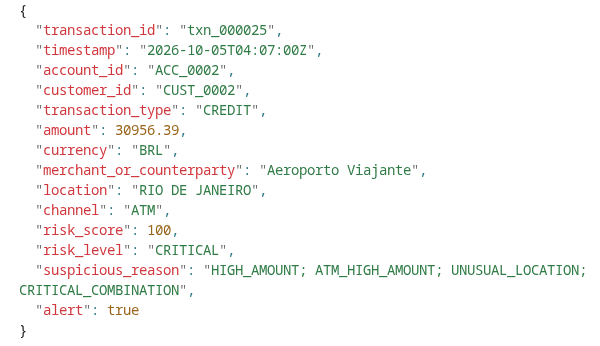
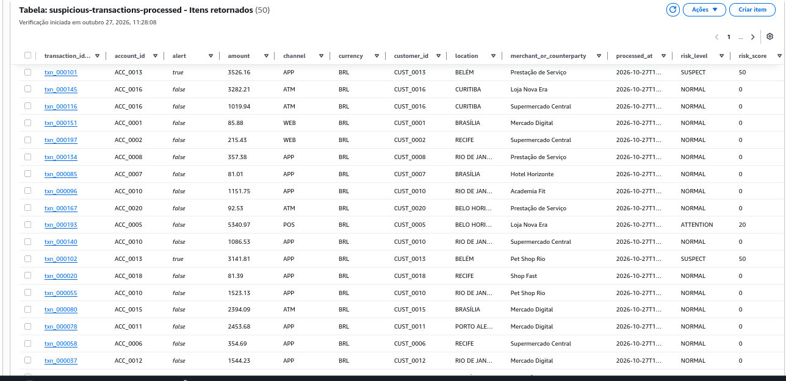
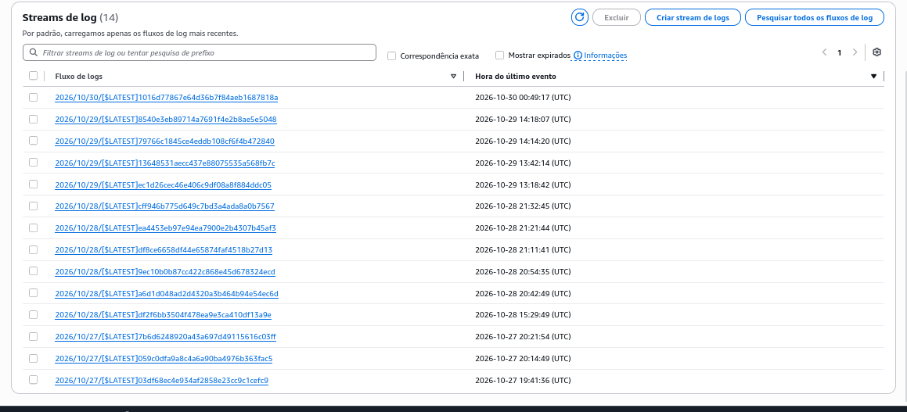
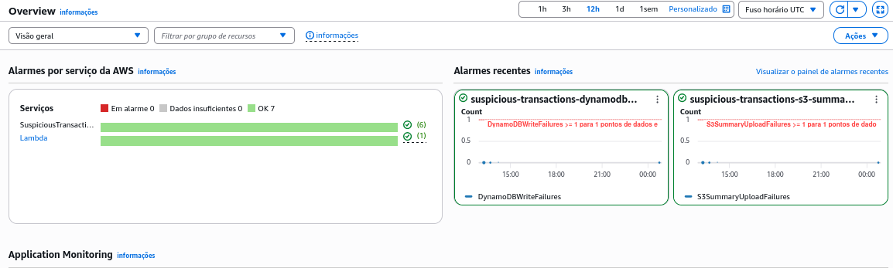

# Detecção de transações financeiras suspeitas

Projeto de portfólio que combina análise de dados, regras de negócio em Python e serviços AWS para processar transações sintéticas e destacar padrões que merecem análise.

## Sobre o projeto

A solução gera lotes fictícios de transações, valida os registros e aplica regras explicáveis para calcular um score de risco. O resultado inclui nível de risco, motivos associados e um resumo operacional com contagens e distribuição dos alertas.

O projeto demonstra um fluxo de dados em lote e, opcionalmente, uma arquitetura orientada a eventos na AWS: o envio de um arquivo JSON ao Amazon S3 pode acionar uma função AWS Lambda para processá-lo. Os dados são sintéticos; as regras são didáticas e não comprovam fraude nem substituem a análise de uma instituição financeira.

## Contexto e justificativa

Instituições financeiras operam sob regulação intensa e precisam conciliar agilidade comercial, prevenção a fraudes e conformidade. O volume de transações, a variedade de canais (APP, WEB, POS e ATM) e a velocidade das operações tornam inviável depender apenas de análises manuais ou de controles pontuais. Esse cenário exige uma arquitetura capaz de transformar exigências regulatórias em controles técnicos mensuráveis, rastreáveis e auditáveis.

No Brasil, o monitoramento de transações dialoga diretamente com:

- **Banco Central do Brasil (BCB):** exige políticas robustas de prevenção à lavagem de dinheiro e ao financiamento do terrorismo (PLD/FT) e monitoramento contínuo, sob risco de sanções administrativas.
- **COAF/UIF:** demanda o reporte tempestivo de operações suspeitas, por meio da Comunicação de Operação Suspeita (COS), alimentando a inteligência nacional contra crimes financeiros.
- **Lei nº 9.613/1998:** criminaliza a lavagem de dinheiro e reforça a necessidade de diligência estrita e guarda de registros.

A justificativa deste projeto é demonstrar, de forma didática e reproduzível, como uma instituição pode estruturar esse controle de ponta a ponta: ingestão de transações, validação e deduplicação, aplicação de regras explicáveis, persistência consultável, geração de alertas e observabilidade. Em vez de propor um produto pronto, o repositório funciona como uma arquitetura de referência mínima para discutir decisões de engenharia, governança e conformidade.

### Da exigência ao controle técnico

A tabela abaixo conecta exigências típicas desse contexto às capacidades técnicas correspondentes e mostra o que já está demonstrado no projeto e o que faria sentido evoluir em um ambiente produtivo.

| Exigência ou diretriz | O que o projeto já demonstra | Evolução sugerida para produção |
|---|---|---|
| Monitoramento contínuo e tempestivo (BCB) | Ingestão por evento no S3, processamento em Lambda, logs estruturados e métricas por lote | Streaming com Kinesis ou MSK, orquestração, SLA, reprocessamento e replay de eventos |
| Reporte de operações suspeitas (COAF/UIF) | Score, nível de risco, motivos, alertas via SNS e resumo operacional do lote | Gestão de casos, workflow de aprovação, integração com sistemas de reporte e trilha de evidências |
| Diligência e guarda de registros (Lei nº 9.613/1998) | Arquivos brutos e processados no S3, logs no CloudWatch e separação entre entrada e saída | Retenção e WORM, criptografia com KMS, lineage, catálogo de dados e legal hold |
| Explicabilidade e revisão humana | Regras determinísticas, motivos associados ao alerta e classificação por faixas de score | Registry de regras e modelos, backtesting, calibração de limiares, revisão de quatro olhos e feedback loop |
| Segregação de funções e mínimo privilégio | Scripts de IAM, role da Lambda e política restrita por recurso | SSO, CI/CD com aprovação, SCPs, acesso break-glass e infraestrutura como código auditável |
| Privacidade, segurança e observabilidade | Dados sintéticos, bucket sem acesso público, criptografia SSE-S3 e alarmes no CloudWatch | Adequação à LGPD, tokenização, KMS/CMK, Macie, GuardDuty, SIEM/SOC e runbooks de incidente |

### Ideias arquiteturais para evoluir a solução

Os blocos abaixo não são requisitos para executar este projeto. São direções para uma instituição que queira transformar a demonstração em um serviço de monitoramento mais próximo de um ambiente regulado:

- **Ingestão híbrida e em tempo real:** combinar lotes históricos com eventos de streaming, usar schema registry e chaves de idempotência, tratar eventos atrasados e permitir replay sem duplicidade.
- **Governança e qualidade de dados:** definir contratos de dados, quarentena para registros inválidos, catálogo, lineage e métricas de completude, consistência e atualidade.
- **Detecção em camadas:** evoluir das regras explicáveis para uma combinação de regras versionadas, features comportamentais e modelos estatísticos, mantendo explicabilidade, backtesting e calibração por segmento.
- **Investigação e gestão de casos:** conectar alertas a uma fila de análise, com priorização por risco, histórico da conta, evidências, comentários e registro da decisão humana.
- **Observabilidade e auditoria:** correlacionar logs, métricas e trilhas de auditoria, acompanhar eficácia das regras, falsos positivos, deriva de comportamento e tempo de resposta aos alertas.
- **Segurança e privacidade:** aplicar minimização e tokenização de dados pessoais, criptografia gerenciada, controle de acesso por função, endpoints privados e monitoramento contínuo de configurações.
- **Engenharia e operação:** adotar infraestrutura como código, pipelines com testes e aprovação, política como código, ambientes separados e resposta a incidentes documentada.

Este projeto é intencionalmente pequeno para manter o fluxo compreensível. O detalhamento da implementação está em [`docs/architecture.md`](docs/architecture.md), as regras estão em [`docs/business_rules.md`](docs/business_rules.md) e o plano de acompanhamento está em [`docs/analysis_plan.md`](docs/analysis_plan.md). Como os dados são sintéticos e as regras são didáticas, qualquer uso real exige calibração com dados históricos, validação independente, avaliação jurídica e de compliance e governança compatível com as obrigações da instituição.

## O que este projeto demonstra

- Geração, validação e análise de dados com Python.
- Regras de negócio explicáveis e classificação por score de risco.
- Métricas descritivas: volume processado, alertas, motivos e contas mais sinalizadas.
- Persistência de arquivos no Amazon S3 e consulta de registros no DynamoDB.
- Publicação opcional de notificações pelo Amazon SNS.
- Observabilidade com logs, métricas e alarmes no Amazon CloudWatch.

## Fluxo de dados

1. O gerador cria um lote fictício de transações em JSON.
2. O processamento valida os registros, remove duplicatas e aplica as regras de risco.
3. A solução calcula um resumo do lote e grava os arquivos processados.
4. No fluxo AWS, o arquivo bruto é enviado ao S3. Um evento de criação no prefixo configurado pode iniciar a Lambda.
5. Quando configuradas, as integrações persistem registros no DynamoDB, publicam alertas no SNS e enviam métricas ao CloudWatch.

## Regras de risco

As regras e seus parâmetros estão em `src/rules/`. Entre os exemplos estão valor alto, uso de ATM com valor elevado, transações acumuladas em uma janela de tempo e canal ou local incomum em relação ao histórico do lote. Os scores são combinados e limitados a 100.

| Nível | Score | Interpretação no projeto |
|---|---:|---|
| NORMAL | 0–19 | Sem regra de alerta acionada |
| ATTENTION | 20–49 | Padrão atípico para acompanhamento |
| SUSPECT | 50–74 | Regra de alerta acionada |
| CRITICAL | 75–100 | Pontuação elevada por combinação de regras |

As classificações são indicadores para fins de demonstração, não conclusões sobre atividade criminosa.

## Tecnologias

- Python 3.11 ou superior
- boto3 para integrações AWS
- Amazon S3, AWS Lambda, Amazon DynamoDB, Amazon SNS e Amazon CloudWatch (modo AWS)
- pytest para os testes automatizados

## Executar localmente

Clone o repositório, crie um ambiente virtual e instale as dependências:

```bash
git clone https://github.com/belemdebelem/transacoes-financeiras-suspeitas.git
cd transacoes-financeiras-suspeitas
python -m venv .venv
source .venv/bin/activate  # Windows: .venv\Scripts\activate
pip install -r requirements.txt
```

Gere e processe um lote local, sem conectar à AWS:

```bash
python main.py --local --transactions 200 --seed 42
```

O comando mostra a quantidade processada, a distribuição por nível de risco, os motivos de alerta e as contas mais sinalizadas. Os arquivos JSON são gravados em `data/raw/` e `data/processed/`; essa pasta é ignorada pelo Git porque contém saídas geradas localmente.

Para gerar um lote diferente, altere `--transactions` e `--seed`:

```bash
python main.py --local --transactions 500 --seed 7
```

## Executar na AWS (opcional)

O modo AWS envia o lote bruto para um bucket S3 e depende de recursos previamente configurados — incluindo o gatilho S3 da Lambda e as permissões IAM correspondentes. Configure as credenciais AWS fora do repositório, por um perfil local ou outro método seguro recomendado pela AWS. Não salve chaves, arquivos de credenciais, ARNs privados ou identificadores da sua conta neste projeto.

Configure o bucket de destino e a região no ambiente e execute:

```bash
export AWS_REGION=us-east-2
export S3_RAW_BUCKET=nome-do-seu-bucket
python main.py --transactions 200 --seed 42
```

Também é possível passar o bucket diretamente com `--bucket`. Sem `--local`, o programa usa AWS e precisa de um bucket configurado. Os scripts de provisionamento em `infrastructure/` são referências para uma conta própria: revise nomes, região, permissões e custos antes de executá-los. O arquivo de política IAM é um modelo e deve ser adaptado à conta e aos recursos de quem o utilizar.

## Estrutura do projeto

```text
src/
  generator/      geração dos dados sintéticos
  processing/     validação, deduplicação e orquestração do processamento
  rules/          regras e classificação de risco
  monitoring/     resumo operacional do lote
  aws/            integrações com S3, DynamoDB, SNS e CloudWatch
infrastructure/   scripts e modelos para provisionamento AWS
docs/             arquitetura, regras e plano de análise
tests/            testes automatizados
main.py           interface de linha de comando
```

## Métricas e resultados

O resumo operacional inclui total de transações, registros inválidos, alertas, taxa de alertas, níveis de risco, motivos identificados e contas com mais alertas. No fluxo AWS, as métricas customizadas são publicadas no namespace `SuspiciousTransactions` quando a configuração de métricas está habilitada. Os arquivos completos de entrada e saída ficam no S3; o CloudWatch registra a execução e os indicadores operacionais.

## Evidências visuais

Os exemplos abaixo mostram saídas com dados sintéticos e telas do ambiente demonstrativo:

**Exemplo de transação processada:**



**Itens processados no DynamoDB:**



**Fluxos de execução da Lambda no CloudWatch Logs:**



**Visão geral dos alarmes do CloudWatch:**



As capturas ilustram uma execução do ambiente de demonstração; os horários e estados refletem aquele momento e podem mudar em outras execuções.

## Testes

Para executar a suíte automatizada:

```bash
pytest
```

## Limitações

- Os dados são gerados artificialmente e não representam clientes ou operações reais.
- As regras usam limiares fixos e um histórico limitado ao lote; não são um modelo estatístico ou sistema de produção.
- Uma sinalização indica que uma regra foi acionada e requer análise humana.
- O fluxo AWS exige recursos, credenciais e permissões configurados pelo usuário.

## Autoria

Projeto desenvolvido por **Belém Ribeiro** como portfólio de análise de dados, com foco em Python, análise exploratória, regras de negócio e fundamentos de engenharia de dados na AWS.
